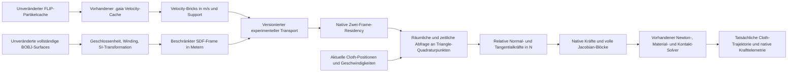

# Experimenteller nativer Hydrodynamik-Datenfluss

Aktueller isolierter Add-on-/Operatorpfad und tatsächliche PC2-Verifikation:
[Blender-End-to-End-Bericht](GAIA_HYDRODYNAMIC_BLENDER_E2E.md).
Der normale Capability-Pfad bleibt ohne explizites Testprofil gesperrt.

Stand: 16.10.2026. Eigenständige Solver-Erweiterung; keine offizielle GAIA-0.26-Capability.

Der Vorbereiter erzeugt keine Cloth-Kräfte. Er verarbeitet jeweils einen
BOBJ-Frame samt BVH und Arbeitsgrid. Geschlossenheit, konsistentes Winding und
positives Volumen sind Voraussetzung. Die BOBJ-Abbildung lautet
`(BOBJ - baked_bounds_min) * scale + current_domain_min`. Für die geprüfte
NEON-Konfiguration ist diese Abbildung die Identität; der Partikeloffset wird
nicht erneut angewandt.

Der unabhängige Transport enthält `hydrodynamics.json`, Version 1, Rollen
`velocity_m_s_support` und `signed_distance_m_x_identity`, SI-Einheiten und
Quellprovenienz. Die Implementierung verwendet die vorhandenen validierten
Vier-Float-Bricks als Speicherformat. Im explizit typisierten SDF-Stream ist
Float 0 eine vorzeichenbehaftete Distanz in Metern und kein Geschwindigkeitswert.
Dieser Stream liegt außerhalb offizieller PARAM-Payloads und wird niemals als
altes Beschleunigungsfeld installiert. Die alte Occupancy bleibt ausschließlich
ein Support-/Vergleichssignal und wird nicht als Flüssigkeitsdichte verwendet.

Beide Streams besitzen dieselben Framezeiten. Native Loader verweigern falsche
Rollen, Einheiten, Versionen, abweichende Zeitachsen, ungültige Daten und fehlende
Frames. Der Solver hält zwei Frames auf dem Device und höchstens drei im
Host-Cache. Volumendaten werden bei einem Framewechsel übertragen; Newton-
Iterationen mit unverändertem Zeitfenster lösen keinen erneuten Frame-Upload aus.

Der Triangle-Kernel interpoliert Fluidgeschwindigkeit und SDF an drei
baryzentrischen Punkten. Die Cloth-Geschwindigkeit wird mit denselben Gewichten
aus dem aktuellen Iterate und dem Startzustand des Zeitschritts berechnet.
Kräfte und gekoppelte Geschwindigkeitsableitungen gehen mit den jeweiligen
baryzentrischen Gewichten in alle Vertex-/Matrixblöcke ein.

Der neue Assembly-Pass liegt **nach dem Snapshot der elastischen Referenzmatrix
und vor den Kontakt-/Reibungsresiduen**. Somit beeinflusst die Wasserlast die
Reibungsberechnung, während ihre Dämpfungsblöcke nicht als Materialsteifigkeit
zur Kontaktkalibrierung behandelt werden.

Benetzung aktiviert ein zweiseitiges Strömungswiderstandsmodell. Vollständiges
Untertauchen bei ruhendem Wasser und Stoff erzeugt keine Kraft. Bei Relativ-
strömung kann auch eine beidseitig benetzte Fläche Widerstand erfahren. Ein
Inside-Test liefert keine gemessene einseitige Druckdifferenz. Hydrostatischer
Druck, Auftrieb, Textildurchströmung und Fluid-Gegenkräfte bleiben aus.

Die SDF ist eine räumliche Näherung; unterhalb der Zellweite liegende Strukturen
können verloren gehen. Die NEON-Validierung vergleicht ihre benetzte Fläche
explizit mit den vollständigen Oberflächen. Native Telemetrie nennt den
tatsächlichen Auswertungszeitpunkt, der vom interpolierten Ausgabe-Framezeitpunkt
abweichen kann.

Dry, alter Fluid Flow und Hydrodynamics sind getrennte Betriebsfälle. Eine
gleichzeitige aktive lineare Fluid-Flow-Last wird im experimentellen Solver
verweigert. Die Blender-Option bleibt bis zur abschließenden Backend- und
Workflow-Validierung deaktiviert.
