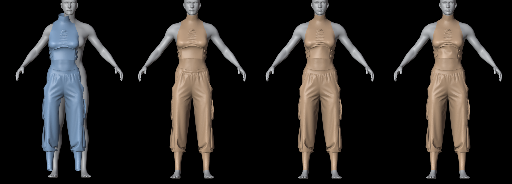
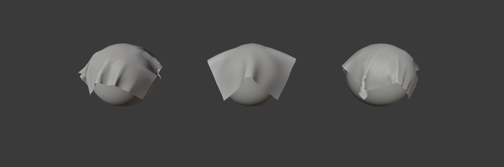
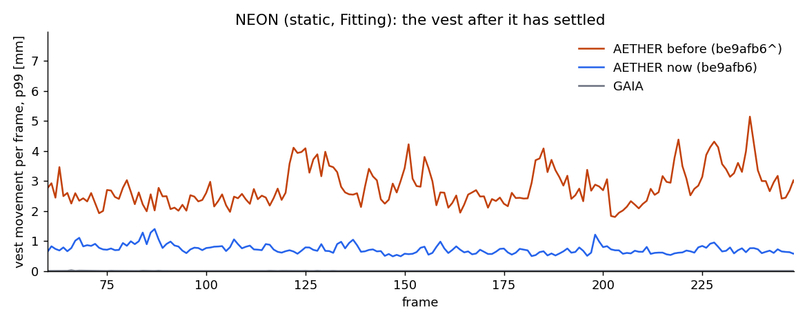
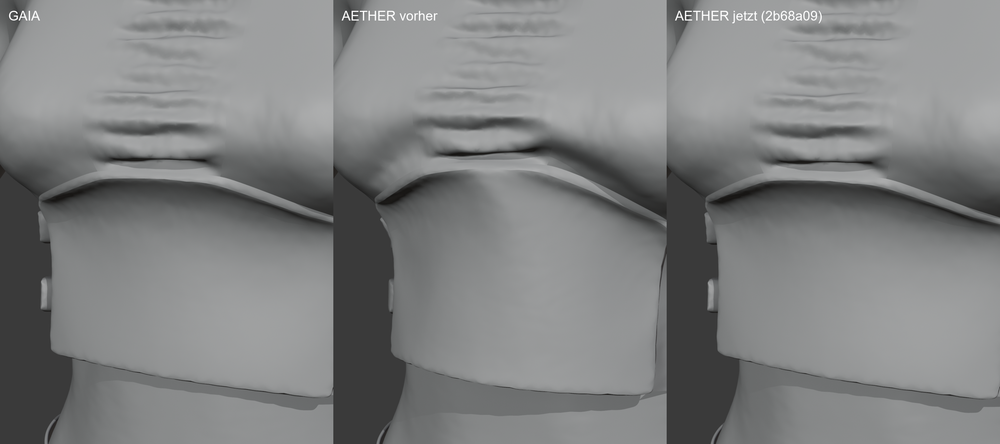

# AETHER Engine: production readiness

Date: 2026-11-02. RTX 4070 SUPER, Windows 11, Blender 5.2.3 LTS. Private test build only: no release, tag,
version change or deployment. GAIA unchanged.

| component | Milestone 5.3 | this pass |
|---|---|---|
| AETHER Engine | `010740b` (build `1339fe67b78d7686`, API 1.2) | `2b68a09` (**API 1.3**, host protocol 1) |
| Cloth NeXt | `0eab4fb` | `e9deb1e` + this report |

The goal was "AETHER must feel like real Marvelous cloth". This pass adds three things:

* the Marvelous drape workflow (simulate, stop without reset, continue from the draped state);
* GAIA/Marvelous-like folding on coarse meshes;
* a robustness guard for fast animated characters.

It also adds strain limiting to the engine, and finds out why that cannot yet be switched on for garments.

## Summary

| area | result |
|---|---|
| Look, NEON frame 248 | MD, GAIA and AETHER look the same at garment scale (image below) |
| Look, coarse sheet | Before, AETHER folded much less than GAIA on coarse meshes. With the resolution factor, folds are 18.8° against GAIA's 16.6°. |
| Drape keep / continue | **Done**: Stop & Keep, Continue, Clear Drape; Live and Bake start from the drape |
| Animated NEON robustness | Normal preset: largest stretch **1.7x** (was 6.3x with the softer bending, 2.2x in 5.3), 0 intersections in all presets |
| Static NEON | 0 intersections in all presets, kill + resume bit-identical |
| Stretch Limit | engine API 1.3 enforces it, but it crumples sewn bands on NEON: **experimental** (`CLOTH_NEXT_AETHER_STRAIN_LIMIT=1`), still reported as not enforced |
| Tests | engine 37/37, host 10/10, Cloth NeXt 2749 passed, GUI smoke PASS (18/18), drape Live + Bake PASS |

Verdict: **go for a private beta**, no-go for a public release (see "Remaining").

## 1. Marvelous drape workflow

In Marvelous you simulate the patterns onto the avatar, stop, and the next simulation continues from the draped state.
AETHER now does the same:

* **Stop & Keep** (the default Stop of the Live Simulation, panel and floating toolbar) stores the simulated
  positions as the shape key `Cloth NeXt Drape` (value 1) on the original object.
* The basis keeps the pattern / rest shape, so the rest lengths, seams and materials are those of the pattern.
* **Continue Live Simulation** and **Bake** start from the drape:
  * Live sends it with `set_state` (also after Reset);
  * the bake sends it as `start_positions` to `create_session` (host, API 1.3);
  * seams count as sewn;
  * PC2 sample 0 is the drape;
  * the drape is part of the scene digest, so cache and resume never mix draped and undraped runs.
* **Clear Drape** removes the key (and a Basis it created) and returns to the pattern.

Tests in Blender (ball scene):

* `drape_test.py`: drape moved 0.87 m from the rest shape; basis unchanged; preview and engine start exactly at the
  drape (0.0 m); Reset returns to the drape; Clear removes it.
* `drape_bake_test.py`: sample 0 is the drape (0.0 m); frame 1 is 17 mm from it; rest shape kept.

## 2. Look: like GAIA and Marvelous

On NEON (≈8 mm edges) the three solvers already looked alike. The gap was on **coarse meshes**. AETHER's discrete
dihedral bending acts more stiffly the coarser the mesh, while GAIA's (and MD's) does not. On the GAIA test sheet
(1 m, 25 × 25 vertices, falls onto a sphere) AETHER stayed an almost flat tent where GAIA folds.

Real GAIA bakes of the same sheet at three resolutions gave the bending factor that matches GAIA's folds (mean
dihedral angle):

| median edge | factor |
|---|---|
| 10.4 mm | 0.17 |
| 20.8 mm | 0.055 |
| 41.7 mm | 0.01 |

`materials.gaia_bending_factor(median_edge)` works like this:

* It interpolates these points log-log per cloth, using the median edge of the rest mesh.
* It extrapolates the last slope towards finer meshes and clamps the result to [0.005, 1].
* NEON's trousers (8.1 mm) get 0.26.
* `CLOTH_NEXT_AETHER_GAIA_BENDING=0` switches it off.

| sheet, frame 71 | GAIA | AETHER with factor |
|---|---|---|
| mean dihedral (folds) | 16.6° | 18.8° |
| lowest point | -0.767 m | -0.768 m |
| RMS distance to GAIA | – | 38 mm (chaotic folding, same character) |

## 3. Stretch guard (engine)

The softer bending exposed a rare event in the animated NEON, Normal preset. A soft fold of the trouser leg was caught
in fast motion, and in the last three frames a region tore open to 6.3x stretch: 507 edges over 30 %. There were still
0 intersections. Two things showed it is a chaotic hit, not a systematic error:

* bending ±20 % was clean;
* 12 instead of 8 maximum substeps was clean, but 40 % slower.

**Fix:** a frame guard (`stretch_guard = 2.0`, `stretch_guard_jump = 0.3`).

* After each frame the largest principal stretch over all triangles is compared with the frame start.
* If it ends above 2.0 and rose by more than 0.3, the frame is repeated from its saved start with twice the substeps,
  up to 2 × the collider maximum (16).
* It only escalates while doubling still lowers the stretch. A stretch that more substeps cannot reduce (pins pulled
  apart) is accepted after one try.
* Frames below the trigger are bit-identical. The parameters are part of the checkpoint fingerprint.

Engine test `stretch_guard`:

* the yanked frame is repeated once, and not escalated, because doubling does not help;
* the frames before it are bit-identical to the guard switched off;
* deterministic.

Animated NEON, 150 frames, through Cloth NeXt (largest edge stretch of the trousers over the whole bake):

| preset | 5.3 (`010740b`, stiff bending) | GAIA bending, no guard | GAIA bending + guard (`169c9c0`) |
|---|---|---|---|
| Normal | 2.17x, 97.8 ms | **6.29x**, 111.3 ms | **1.71x**, 117.8 ms |
| Animation | – , 123.8 ms | 1.94x, 137.7 ms | 1.73x, 149.9 ms |
| Fitting | – , 141.6 ms | 1.53x, 158.9 ms | 2.15x (frame 3), 164.9 ms |

All runs: 0 cloth-collider and 0 cloth-cloth intersections in every frame.

Static NEON, 248 frames, with the final engine:

| preset | ms per frame (mean) | notes |
|---|---|---|
| Normal | 13.8 | 0 intersections |
| Animation | 20.1 | 0 intersections |
| Fitting | 26.8 | 0 intersections; kill at frame 120 + resume byte-identical |

* In 5.3 these were 12.9 / 18.9 / 25.3 ms. The softer bending costs about 6 %.
* The guard repeats frame 1 once, where the seams pull the panels together (about 75 ms extra, once).

## 3b. Calm resting cloth (engine `be9afb6`)

Tim noticed the vest in NEON jittering. Measured on the settled drape (static NEON, Fitting, frames 124-248):

* GAIA's vest moves less than 0.01 mm per frame.
* AETHER's vest moved 0.46 mm on average and up to 10 mm, with random sign.
* It was worst at the back on waist height, where the vest lies on the second garment piece.

Both rejected hypotheses made it worse, and were reverted:

* one symmetric stiffness per cloth-cloth contact;
* a halved contact step in the sweeps.

Measured: switching self-collision off made it 70x calmer, so the cloth-cloth contact causes it. More solver iterations
made it worse. Without the Newton step it was 4x calmer.

**Cause:** the global Newton step sees cloth-cloth contacts only through the lagged set. In a resting layered garment it
pushed vertices up to half an edge into the neighbouring layer every substep, and the VBD sweeps pushed them back.

**Fix:**

* The Newton step's motion of a vertex *towards* each lagged cloth-cloth partner is limited to 0.1 x its shortest
  edge (`newton_trust_self_contact`).
* Tangential motion and motion away from the partner are free.
* A plain tighter trust region on such vertices also calmed it, but slowed attachments pulling cloth out of a crumple.

Replay, 3 trajectories each, frame-to-frame acceleration (mm):

| | vest | band | trousers |
|---|---|---|---|
| before | 0.58 | 0.30 | 0.11 |
| after | 0.14 | 0.15 | 0.10 |

There were 0 intersections and the cost did not change.

In Blender with the staged engine:

* the vest's p99 movement per frame went from 2-5 mm to 0.5-1 mm;
* static NEON: 13.3 / 19.6 / 26.1 ms per frame;
* animated NEON: 112 / 135 / 155 ms per frame;
* 0 intersections everywhere; kill + resume byte-identical.

Engine tests 37/37. Two thresholds were adjusted with the measured spread:

* `runtime_pins`: the compliant pin's lag in a crumple measured 2.0-3.3 cm across solver settings, so the limit is now
  4 cm. A lost attachment stays near 10 cm.
* `untangle_hardening`: the plain reference run got calmer (3.08 → 2.02 m/s) while the recovery is unchanged
  (3.49 m/s), so the margin is now 1.5 m/s.

Still open: GAIA settles completely, while AETHER keeps a residual of about 0.5 mm. Slow slip bursts of about 100
vertices still occur; a better static-friction model is the next lever.

## 3c. Cubic contact law and the stiff vest (engine `98a1178`)

**Stiffness.** Tim found NEON's vest stiff in the GAIA bake but soft in AETHER. Measured over the bake:

| | median deformation | p95 deformation |
|---|---|---|
| GAIA | 0.4 mm | 0.8 mm |
| AETHER | 2.5 mm | 12.5 mm |

The difference is concentrated in the free-standing lower front.

* **Cause:** the contact gap. PPF's contact-gap is the activation distance of an IPC barrier, and layers rest inside it.
  AETHER's quadratic penalty held the full gap and pushed the vest off its band, which lies about 1 mm away.
* **Ruled out:** the material stiffness arrives correctly. More iterations, more Newton steps and 10x bending made no
  difference.
* **Inlay zone:** the vest's "Inlay" zone (young-mod 10, 4.65 N/m) is intentional.

**Contact law.** Mesh contacts now use a cubic law, E = k (gap - d)^3 / (3 gap):

* zero force at the gap;
* the penalty's maximum k·gap at contact;
* stiffness 0 to 2k.

Contacts between two different cloths keep 0.5 x the summed thickness as their gap.

**Measured** (NEON Fitting replay, vest / band / trousers frame-to-frame jitter in mm):

| | vest | band | trousers |
|---|---|---|---|
| before | 0.13 | 0.15 | 0.09 |
| cubic | 0.004 | 0.003 | 0.002 |

The cost stayed the same.

**Blender, staged engine:**

| scene | ms per frame | before |
|---|---|---|
| static NEON | 13.1 / 19.0 / 25.0 | |
| animated NEON | 108 / 129 / 147 | 112 / 135 / 155 |

* 0 intersections everywhere: ball, static and animated NEON;
* largest stretch in animated NEON 1.94x / 1.86x / 1.36x;
* kill + resume byte-identical.

Engine tests 37/37, host 10/10.

**Rejected:**

| idea | result |
|---|---|
| IPC log barrier | oscillates in the VBD sweeps, 2.4x slower |
| thin gap for all contacts | animated NEON explodes |
| thin gap only for vertices layered at the start | no gain |
| symmetric contact stiffness, halved contact step, lagged friction normal force | no gain |

**Open:** a 0.5 gap for every cloth-cloth contact (`AETHER_EXP_SELF_GAP_ALL=1`):

* holds the vest like GAIA: 0.47 / 1.05 mm, against GAIA's 0.37 / 0.83;
* fails `deforming_colliders`, where a tightly pinched elbow sleeve passes through itself.

The vest is calm now but still softer than in GAIA (2.2 / 8 mm).

**Stretch Limit:** a stiff penalty (300) stalls a sewn garment at its limit: NEON's vest median stretch was 1.042,
against 1.003 without limits. A soft penalty (3) fixes NEON but fails the `strain_limit` test (10.6 % for 5 %). It
stays off in Cloth NeXt.

Correction: `14ffd37` was reported green on a stale test binary. `ba7278a` reverted it.

## 3d. The vest as stiff as in GAIA (engine `2b68a09`, default)

Cloth-cloth contacts now keep half the gap in two cases, and the full gap otherwise:

* between different cloths;
* within one cloth, when the pair moves less than half the gap relative to each other over the substep.

Exceptions:

* Hard pins and their 2 rings keep the full gap (`pin_rings`), because the CCD may revert a pin to its substep start.
* Making pins kinematic in the CCD instead was tried in three variants. Each broke the pinned fold swept by a ball, or
  the untangling, so the CCD is unchanged.
* A sleeve pinched by a bending elbow keeps the full gap and stays intact.

**Vest deformation over the bake (Blender, static NEON, Fitting):**

| | median | p95 | max |
|---|---|---|---|
| GAIA | 0.37 mm | 0.83 mm | 2.2 mm |
| AETHER this morning | 1.99 mm | 10.9 mm | 17.7 mm |
| AETHER now | 0.47 mm | 1.05 mm | 2.5 mm |

Frame-to-frame jitter of all three garments is below 0.002 mm.

**Blender regression with the staged engine:**

| scene | ms per frame | before |
|---|---|---|
| ball | 8.6 / 15.7 | |
| static NEON | 12.6 / 18.9 / 24.5 | 13.3 / 19.6 / 26.1 |
| animated NEON | 111 / 127 / 141 | 112 / 135 / 155 |

* 0 intersections in every scene;
* largest stretch in animated NEON 1.69x / 1.76x / 1.41x;
* kill + resume byte-identical.

Engine tests 37/37 after a full rebuild, host 10/10.

## 4. Strain limiting (engine API 1.3, experimental in Cloth NeXt)

`ae_set_cloth_strain_limit` / material and zone `strain_limit` in the host has two parts:

1. **Penalty.** A penalty on the principal Green strains beyond the limit:
   * Gauss-Newton Hessian;
   * active in the VBD sweeps, the line search, the Newton assembly and the lane kernels;
   * its terms sit in separate loops and kernels, so solves without limits are bit-identical (the inline version
     changed the compiler's FMA choices and was bisected out).
2. **Projection.** A pin-anchored, per-colour Gauss-Seidel projection of the singular values.

Engine test: a sheet that stretches 26 % freely stays below 7.5 % with a 5 % limit, including zones and material edits.

**Why it is not on for garments:** on NEON the penalty fights the seams and crumples the sewn band below the chest. The
projection alone is harmless but too weak to matter. Cloth NeXt therefore sends limits only with
`CLOTH_NEXT_AETHER_STRAIN_LIMIT=1`, and keeps reporting Stretch Limit as not enforced (panel, bake message, cache
sidecar).

A "compression scale" (buckling) experiment reduced wrinkles instead of adding them and was dropped.

## 5. Validation run (final engine `169c9c0`, Cloth NeXt `e9deb1e`)

| check | result |
|---|---|
| `aether_tests.exe` | 37/37 (new: `stretch_guard`) |
| host tests | 10/10 |
| Cloth NeXt `pytest tests` | 2749 passed, 40 skipped (+ GAIA bending factor test) |
| engine staged in the test environment, `verify_engine.py` | ok (sha256, build id, commit, protocol, API, clean exit) |
| ball scene Normal / Fitting | finished, 0 intersections |
| static NEON Normal / Animation / Fitting + kill/resume | finished, 0 intersections, resume byte-identical |
| animated NEON Normal / Animation / Fitting | finished, 0 intersections, max stretch 1.71 / 1.73 / 2.15 |
| GUI smoke (real Blender window) | 18/18 checks |
| drape Live / drape Bake | PASS / PASS |

Not re-run in this pass: the M5.3 stress scenes and the MD job runner. The guard can only add substeps, but the stress
scenes should be re-measured before a release.

## 6. Remaining (honest list)

* **Collision hard cases** (pre-existing, M5.2/5.3 stress scenes): `elbow_run`, `elbow_layers`, `leg_swing`,
  `four_balls`, `elbow_coarse` still show intersections or need more substeps than the cap.
* **Stretch Limit** that coexists with seams.
* **Unsupported controls** (refused, not approximated):
  * Shrink, Surface Offset, Inflate / Pressure;
  * Permanent Stretch or Bends, flat bend rest, Shape-Preserving model;
  * Friction Regions, Pin Target Objects, Advanced Pin Motion;
  * wind / force fields.
* **Bending calibration** comes from one sheet scene against GAIA at three resolutions. Marvelous itself was compared
  on NEON and on its own sphere runs, not on the coarse sheet.
* **Distribution:**
  * the engine is not vendored in a release workflow;
  * no packaged-ZIP integrity check for AETHER yet;
  * the binary is unsigned;
  * Windows and one GPU only.

## 7. Go / no-go

* **Go** for Tim's private beta with this engine. Garments look and drape like GAIA/MD, the Marvelous drape workflow
  works, and animated characters run without intersections and without torn regions in all presets.
* **No-go** for a public release until:
  * distribution (vendoring, integrity check, signing) is done;
  * the stress-scene hard cases are fixed or clearly reported in the UI;
  * more GPUs and garments are validated.
