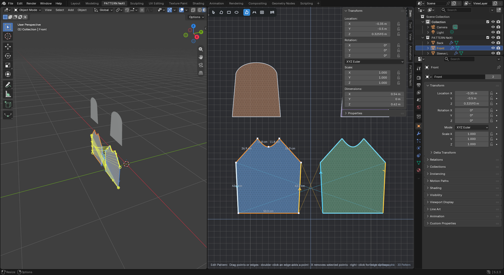
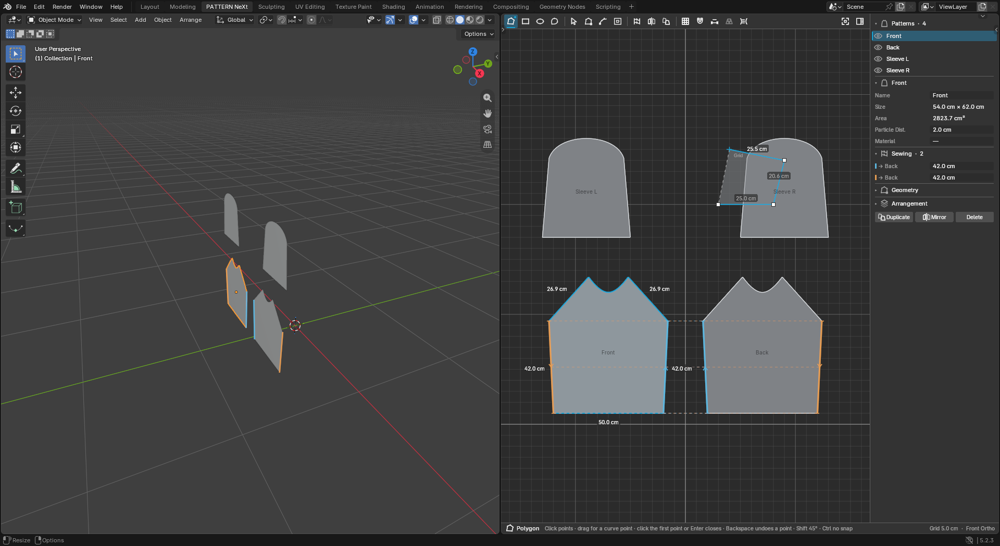
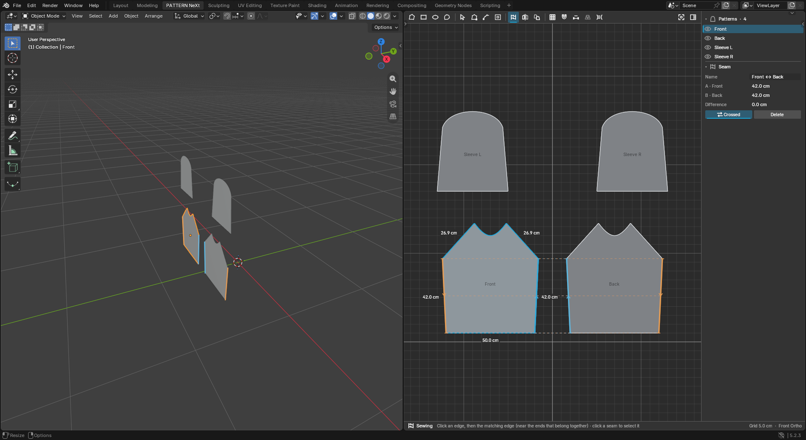
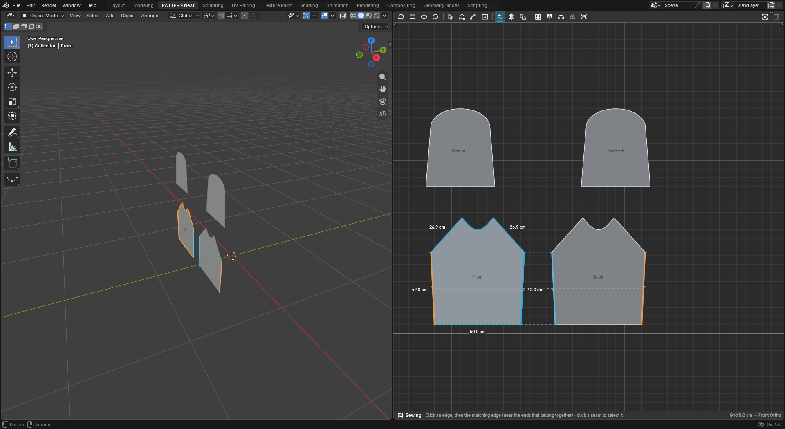
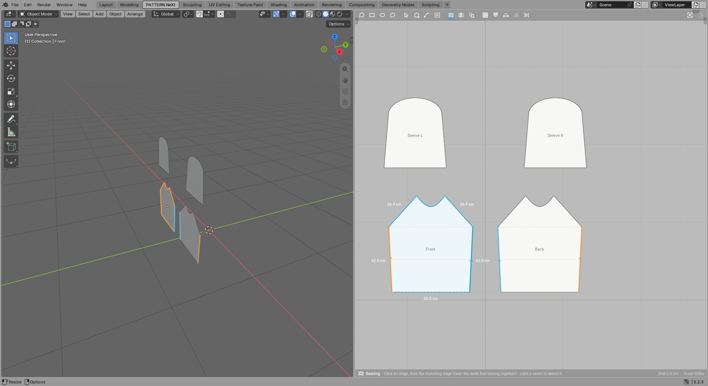
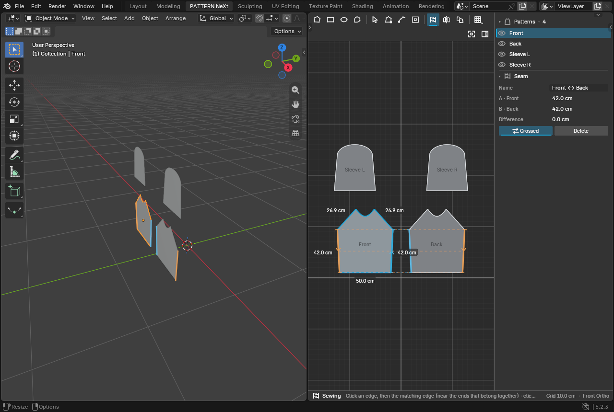
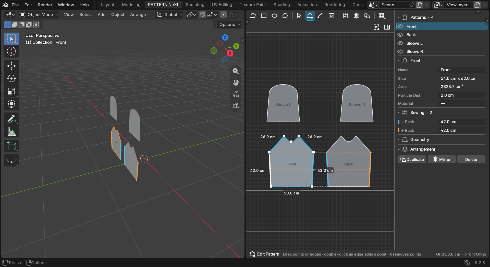
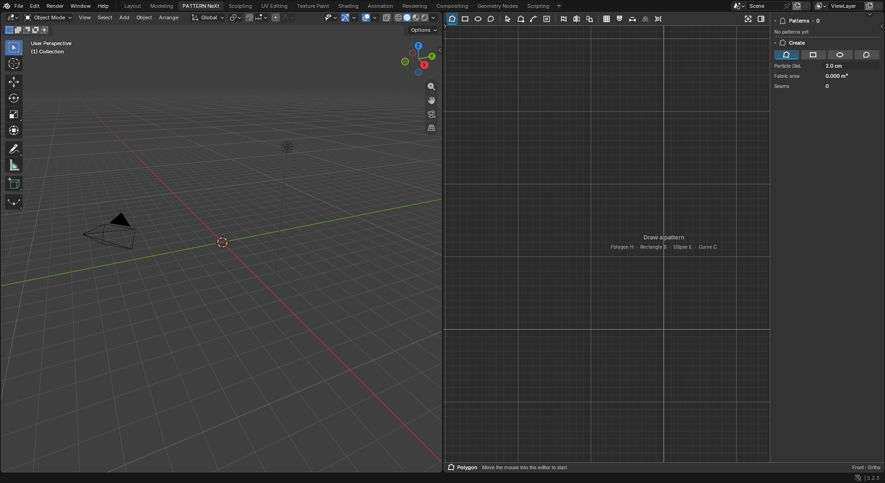
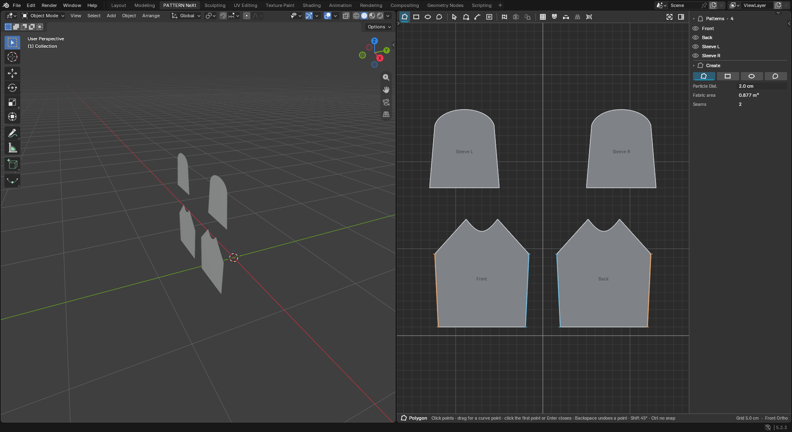

# PATTERN NeXt — UI/UX Redesign

Date: 2026-11-01 · Blender 5.2.3 LTS (Windows 11) · Branch
`claude/project-thread-uc32sv` · Cloth NeXt 2.9.52 (no version change, no
release, no deployment). Builds on the Milestone 6.0 workspace
([report](PATTERN_NEXT_WORKSPACE_REPORT.md)); geometry, meshing, physics,
caches, AETHER and GAIA are unchanged.

All screenshots are real Blender captures taken by
`tools/blender_pattern_ui_shots.py` (a demo garment: front, back, two
sleeves, two side seams) and `tools/blender_pattern_gui_acceptance.py`.

## 1. Audit of the original interface

Before screenshots: [`pattern_next/redesign/before/`](pattern_next/redesign/before/).

| Area | Problem found |
| --- | --- |
| Colour discipline | Every pattern got a random saturated fill (blue, green, brown, purple, olive); selection orange, seams yellow/cyan, invalid red, grid axes blue: many accents, none meaning "selected". |
| Toolbar | A floating rounded capsule of 15 tiny vector glyphs (icon-only below ~980 px), several near-identical silhouettes, a large saturated blue block for the active tool, tooltips only for some buttons. Looked like a web widget, not part of the editor. |
| Status | Hint text at the bottom left ran into the "Front · Orthographic" label at the bottom right. |
| Sewing | Every seam drew colour, arrows and nine thread lines permanently; two side seams produced a crossing web over the whole canvas. |
| Measurements | All segment lengths of the selected pattern were drawn at the midpoint with a shadow, overlapping at short neckline edges ("11.8 cm11.8 cm") and sitting on the outline. |
| Triangulation | Mesh wire on by default, so every pattern looked like a wireframe. |
| Canvas | Flat grey close to Blender's own background; minor and major grid lines similar; patterns lacked names. |
| Inspector | Blender's N sidebar opened on the "Item" tab (object transform), overlapping a third of the canvas; PATTERN panels were five equal-weight stacked panels with the same content regardless of selection; the pattern list showed triangle counts in every row. |
| Left 3D view | The Cloth NeXt Sewing overlay drew yellow thread webs between the panels; no arrangement controls. |
| Narrow editor | Toolbar buttons were simply hidden under the sidebar. |

## 2. Design system

Implemented in `cloth_next/blender/pattern_next/style.py`.

* **Surfaces from the Blender theme**: tool strip, status strip and inspector
  use the 3D View header colour and text colour of the user's theme; the
  canvas is a slightly darker (dark themes) or lighter (light themes)
  variant. Nothing changes the user's theme.
* **One accent**: Cloth NeXt cyan (the simulation toolbar's colour) marks
  the active tool, the selection and active controls. Nothing else is cyan.
* **Functional colour only where it is data**: eight equally muted seam
  identities, red for invalid geometry, amber for warnings (seam length
  difference). Patterns are neutral (mid-grey on dark, near-white on
  light), tinted only by an assigned material's viewport colour.
* **Metrics** (multiplied by Blender's UI scale): tool strip 30 px, buttons
  26 px with 3 px corners, status strip 22 px, vertex handles 6 px,
  inspector 248 px (capped at 42 % of the editor), 10–11 pt text. No
  shadows, glows, gradients or blur; separators are 1 px.
* **Icons**: 23 original monochrome icons in the Cloth NeXt line style
  (24 px grid, 1.8 px round strokes, same as `assets/cloth_next_icons`),
  sources in `assets/pattern_next_icons/`, rendered by
  `tools/build_pattern_icons.py` at 18, 27 and 36 px (crisp at 100/150/200 %
  UI scale) and 64 px for previews. Sewing reuses the existing Cloth NeXt
  sewing glyph. Tinted at draw time: full, dim (toggle off), 25 % (disabled).

## 3. What changed

### Tool strip (`toolbar.py`)
Docked to the top of the 2D editor, flat, theme-coloured. Groups:
**Create** Polygon · Rectangle · Ellipse · Curve | **Edit** Select · Edit
Pattern · Edit Curve · Internal Shape | **Construct** Sewing · Mirror ·
Duplicate | **Display** Grid · Snap · Measurements · Triangulation · Sewing
Display, and on the right **Inspector** and **Frame All**. Active tool: a
cyan-tinted plate plus a 2 px cyan underline (red underline when the last
action failed, a small dot while a draft or drag is in progress). Toggles
are neutral: bright icon when on, dim when off. Mirror/Duplicate are
disabled without a selection. Every button has a tooltip with name,
purpose and shortcut. When the editor is too narrow for one row the
Display group folds into one button opening a native popover, and groups
wrap onto further rows; a group is never split and Inspector/Frame stay
reachable.

### Status strip
Bottom of the 2D editor: active tool icon and name, its hint or the latest
message (red for errors), right-aligned grid step and "Front Ortho". Text is
truncated with an ellipsis instead of overlapping.

### Canvas (`draw.py`)
Theme-derived drafting canvas; adaptive grid whose minor lines fade in with
their on-screen spacing while 10× majors and the axes stay; neutral fills;
1.25 px outlines (2 px cyan when selected, softly accented on hover, red when
invalid); pattern names at the centre when the pattern is large enough on
screen; triangulation off by default and drawn faint when on; dashed
internal lines; an empty-canvas hint listing the creation tools.

### Points, handles, snapping, feedback (`editor.py`)
Corner points as small squares, smooth points as discs, selected points
cyan, Bezier handles as small diamonds on thin lines, the hovered point or
handle ringed in cyan. Snapping shows a small cyan cross (with a ring for
point/edge snaps) and a tiny label. The Polygon draft is cyan with a
neutral fill preview and a dashed closing edge (red when the outline would
cross itself); the closing point is ringed with a "Close" label; segment
lengths are shown only where they fit, the active segment always.

### Measurements
Selected pattern only, placed outside the outline along the edge normal on
a small canvas-coloured plate, skipped when the edge is shorter on screen
than its label, de-overlapped against each other. Selecting an edge in
Edit Pattern labels that edge even if the pattern is not selected.

### Sewing visualisation
All seams: coloured seam edges with drafting notches at both ends.
Emphasised seams only (selected patterns, hovered seam, seam chosen in the
Sewing tool): direction chevrons and three dashed connectors, plus an amber
"Δ length" label when the sides differ by more than 2 % (and 3 mm). In the
Sewing tool the first chosen edge stays highlighted and the pairing with
the hovered edge is previewed before the second click; clicking an existing
seam selects it (Shift-click starts a new seam on an already sewn edge).
In the 3D view the generated Cloth NeXt sewing definitions no longer show
the Cloth NeXt Sewing thread overlay by default (it can be enabled per seam
in the Cloth NeXt Sewing list); instead the seams of selected panels are
drawn as thin coloured edges on the panels.

### Inspector (`dock.py`, `inspector.py`) — not the N sidebar
After review Tim asked for no N panel. Blender's Properties editor does not
let an add-on place a section at the top of a tab (tested in 5.2.3: a
negative `bl_order` is ignored and a context-less panel is not shown), so
the inspector is a docked column on the right edge of the 2D editor, like a
garment application's property editor. PATTERN NeXt registers no sidebar
panels and the N sidebar stays closed.

* **Pattern list**: every pattern with visibility eye (hides it in 2D and
  its panel in 3D), name, cyan bar for the selection, red name when
  invalid. Click selects (in both editors).
* **Context section** below the list, following the selection:
  *Overview* (create buttons, default Particle Distance, fabric area, seam
  count) · *Pattern* (name, size or editable width/height for primitives,
  area, Particle Distance, material; collapsible Sewing, Geometry,
  Arrangement; Duplicate · Mirror · Delete) · *N patterns* (total area,
  actions, arrangement) · *Point* (X, Y, Corner/Smooth, Remove) · *Edge*
  (Length, Straight/Curved, Add Point) · *Seam* (name, both sides with
  lengths, difference, Crossed, Delete).
* Values are edited with Blender's own field: clicking a value opens a
  small native popover with exactly that property (units, drag, typing,
  undo as usual). Point X/Y and edge length go through the same validated
  commit as the tools and are one undo step each.
* Collapsible sections, wheel scrolling, I or the strip button hides it;
  the canvas, framing and tool strip use the remaining width.

### Workspace (`workspace.py`, `ui.py`)
2D editor: Blender header and sidebar hidden, inspector docked. At Tim's
request the workspace has no Outliner and no Properties column any more:
the 3D view and the 2D editor share the full window width (template rebuilt;
workspaces from older files lose that column once, through Blender's own
area-close operator, on first use). The 3D view's header gets an
**Arrange** menu (place in front/behind, reset to staging, seam display)
in this workspace only. Frame All fits the patterns into the visible canvas
(between tool strip, status strip and inspector).

### New tool: Curve (C)
Clicks place smooth points whose tangents follow their neighbours
(Catmull-Rom), giving a curved outline without handle work; dragging while
placing a point still sets its tangent explicitly.

## 4. Visual validation (real Blender 5.2.3)

After screenshots: [`pattern_next/redesign/after/`](pattern_next/redesign/after/).

| | |
| --- | --- |
|  1920 × 1080, pattern selected, Edit Pattern |  Polygon tool |
|  Sewing tool, seam selected |  Triangulation visible |
|  Inspector collapsed |  Blender Light theme |
|  Narrow 2D editor (1280 × 860 window): wrapped strip, Display folded |  UI scale 150 % |
|  Empty scene |  Several panels, none selected |

Checked on the captures: no overlapping toolbars, no clipped labels (long
hints end in an ellipsis), icons aligned on one baseline and equal button
sizes, legible text at 100 % and 150 %, measurements outside the outlines
and never on top of each other, the inspector never covering the active
drawing, 3D and 2D views keeping their working space.

**Not testable on this machine:** a real 2560 × 1440 window. The test
display is 1920 × 1080 and Blender clamps the window to the screen (the
"2560 × 1440" run produced a 1920 × 1049 window). Layout code uses only
region sizes and the UI scale, and was verified at 1920 × 1080, 1280 × 860
and 150 % scale (which has the same logical width as 2880 px at 100 %).

## 5. Usability walk-through and automated acceptance

`tools/blender_pattern_gui_acceptance.py`, real windowed Blender with
simulated mouse/keyboard, **create: 67 / 67 passed, reopen: 7 / 7 passed**
([results](pattern_next/redesign/acceptance/)). New checks for this
redesign: inspector docked and N sidebar closed, I hides the inspector, a
toolbar button activates its tool, a toolbar toggle switches the
triangulation, the Curve tool creates a smooth pattern, selecting a point
or an edge shows point/edge controls, editing X and Length in the
inspector moves the point / sets the edge length, a list click selects
the pattern, the visibility eye hides and shows the 3D panel; plus all
Milestone 6.0 checks (workspace, view lock, drawing, editing, Particle
Distance, rectangle/ellipse/curve, selection sync, sewing, hole, copy/paste,
rotate, linked mirror, undo/redo, add-on reload, save and reopen).

| Step | Can the artist find it? | Feedback |
| --- | --- | --- |
| Open PATTERN NeXt | Workspace tab | Empty canvas shows "Draw a pattern" with the four create shortcuts; Overview lists create buttons. |
| Create a polygon | First Create button / H | Cyan draft, lengths, fill preview, dashed closing edge, ringed "Close" point. |
| Close it | Click first point / Enter | Filled immediately; selected (cyan outline, list row, 3D panel). |
| Change Particle Distance | Inspector → Pattern → Particle Dist. | Native field; mesh rebuilt; Geometry section shows the triangle count. |
| Edit an outline vertex | Edit Pattern / Z | Ring on hover, cyan when selected, inspector shows X/Y to type. |
| Curved pattern | Curve / C, or Edit Curve / V | Smooth outline from clicks; handles as diamonds. |
| Select multiple patterns | Shift-click | Inspector switches to "N patterns" with total area and actions. |
| Sewing relationship | Sewing / M | First edge highlighted, pairing preview, seam with notches/chevrons; inspector shows lengths and difference. |
| Arrange in 3D | 3D header → Arrange, or inspector Arrangement | Panels move in 3D only; the 2D pattern is unchanged. |
| Save and reopen | File | Everything restored, inspector and lock as before. |

Awkward spots found during the walk-through and fixed: the sidebar opened
on Blender's Item tab (now: no sidebar at all); framing put patterns under
the inspector (now fits the visible canvas); seam editing required the
Cloth NeXt list (now: click the seam); point coordinates and edge lengths
could only be dragged (now typed in the inspector).

## 6. Regression

* Geometry check in Blender: unchanged (18 / 18, invalid shapes rejected,
  adapter snapshot matches the sewing definitions).
* Full pytest suite after the redesign: **2781 passed**, 40 skipped
  (platform/engine-dependent), 0 failed (M6.0 baseline: 2777 passed).
* Behaviour changes (documented and covered by the acceptance run): the
  triangulation display defaults to off; pattern-derived Cloth NeXt sewing
  definitions start with their 3D thread overlay off and no longer change
  the Cloth NeXt Sewing list selection; clicking an existing seam in the
  Sewing tool selects it (Shift-click to sew an already sewn edge); the
  workspace no longer has the Outliner/Properties column; new keys C (Curve) and
  I (Inspector), number keys 1-9.

## 7. Files changed

New: `cloth_next/blender/pattern_next/style.py`, `dock.py`, `inspector.py`;
`assets/pattern_next_icons/*.svg`; `cloth_next/assets/icons/pattern_next/*.png`;
`tools/build_pattern_icons.py`; `tools/blender_pattern_ui_shots.py`.
Rewritten: `toolbar.py`, `draw.py`, `ui.py` (no sidebar panels; popovers
and the Arrange menu). Changed: `editor.py` (strip/dock input, Curve tool,
point/edge/seam selection, new drawing), `properties.py` (tool table, display
settings, inspector fields, pattern visibility), `operators.py` (set tool,
point type, seam select), `sync.py` (visibility, sewing overlay default),
`workspace.py` (configuration v3), `tools/blender_pattern_gui_acceptance.py`,
`docs/PATTERN_NEXT.md`.

## 8. Known remaining limitations

* The inspector is custom-drawn (GPU) because Blender offers no native
  docked panel area for an add-on inside one editor; its values are edited
  with native popovers. Keyboard focus/tab navigation inside the inspector
  is not available.
* Tooltips appear immediately on hover (no delay) and are drawn by the
  editor, not by Blender's tooltip system.
* 2560 × 1440 could not be captured on the 1920 × 1080 test display.
* The 3D view keeps Blender's own header and tools (by design); only the
  Arrange menu is added.
* Light theme: measurement plates follow the canvas colour; on very
  unusual custom themes the derived canvas may need a manual grid step.
