# PATTERN NeXt Workspace — Milestone 6.0 Validation Report

Date: 2026-11-01 · Blender 5.2.3 LTS (Windows 11, Steam build e13b728c6880)
Branch: `claude/project-thread-uc32sv` (based on `main` 0eab4fb, which contains
the AETHER Engine integration) · Cloth NeXt 2.9.52 (no version change, no
release, no deployment).

PATTERN NeXt is implemented inside the existing Cloth NeXt extension: same
`blender_manifest.toml`, same extension id `cloth_next`, registered through
`cloth_next/blender/registration.py`. User guide: [`docs/PATTERN_NEXT.md`](../PATTERN_NEXT.md).

## Summary

| Gate | Result |
| --- | --- |
| Real-GUI acceptance, Blender 5.2.3, simulated mouse/keyboard, session 1 | **55 / 55 passed** |
| Real-GUI acceptance, session 2 (new Blender process, reopened .blend) | **7 / 7 passed** |
| Geometry validation in Blender (18 shapes, Blender CDT) | **18 / 18 passed**, 5 / 5 invalid shapes rejected |
| Unit tests, geometry core (`tests/test_pattern_next_geometry.py`) | **21 / 21 passed** |
| Full Cloth NeXt pytest suite | see "Regression" below |
| Blender registration smoke (`tools/run_blender_smoke.py`) | passed (register/unregister twice, add/remove physics) |
| Blender Sewing smoke (`tools/blender_sewing_smoke.py`) | passed |
| Sewing GUI acceptance (`tools/blender_sewing_gui_acceptance.py`) | 32 passed, 1 failed — **same single failure on unmodified `main`** (pre-existing, not caused by PATTERN NeXt) |

Raw results: [`pattern_next/gui/acceptance-create.json`](pattern_next/gui/acceptance-create.json),
[`pattern_next/gui/acceptance-reopen.json`](pattern_next/gui/acceptance-reopen.json),
[`pattern_next/geometry.json`](pattern_next/geometry.json). Screenshots below
are unedited `screen.screenshot` captures of the real Blender window taken by
the acceptance script.

## How it was tested

* `tools/blender_pattern_gui_acceptance.py -- <dir> create` starts a windowed
  Blender 5.2.3 with `--factory-startup --enable-event-simulate`, enables
  Cloth NeXt from the source tree, and drives the UI only through
  `window.event_simulate` (mouse moves, clicks, drags, keys, wheel, Ctrl+Z).
  Coordinates are computed from canvas positions through the real region
  projection, so every click goes through Blender's event queue, the 2D
  editor's modal handler, the toolbar hit test and the draw callbacks.
  It saves `pattern_acceptance.blend` and quits.
* `... <dir>/pattern_acceptance.blend ... -- <dir> reopen` is a new Blender
  process that loads the file and keeps editing.
* `tools/blender_pattern_geometry_check.py` (background Blender) meshes the
  acceptance shapes with Blender's own `delaunay_2d_cdt` and checks each mesh
  with `cloth_next/pattern_next/quality.py`, which recomputes everything from
  the parametric shape.

## Final acceptance scenario (as tested)

| Step | Observed in Blender 5.2.3 |
| --- | --- |
| Cloth NeXt enabled | "PATTERN NeXt" tab appears in the top workspace bar next to Layout … Scripting; Blender stays on Layout (no focus steal); Layout unchanged. |
| Click the tab | Two side-by-side editors (737 px / 735 px): left a perspective 3D View, right the 2D Pattern editor, front orthographic, Blender's rotation lock set. |
| Try to rotate the right editor | Middle-mouse drag, Numpad 7/3/1/9, Numpad 5 (perspective) and Numpad 0 (camera), also with Ctrl: view rotation and projection unchanged. Wheel zoom and Shift+Middle pan work. The left view orbits freely. |
| Polygon tool (H), click 6 points, click the first point | One pattern, immediately filled: 1256 vertices / 2384 triangles at 20 mm, interior vertices present, all triangles, area equal to the drawn outline. The panel appears in the left 3D view as a real mesh, a Cloth NeXt Cloth object, selected. |
| Edit Pattern (Z), drag a point | The point moves, the pattern remeshes (revision 1 → 12 during the drag: live remesh), the 3D mesh changes. |
| Drag an edge / double-click an edge / drag into self-intersection | Both edge points move / a point is added / the edit is shown red and rejected ("Pattern outline crosses itself"), mesh kept. |
| Particle Distance 20 → 10 → 30 mm | 2781 → 11174 → 1217 triangles. |
| Rectangle (S) and Ellipse (E) drags | Filled immediately; area 0.16 m² and π·0.2·0.15 m²; the ellipse keeps 4 smooth Bezier points; changing the rectangle size remeshes. |
| Edit Curve (V), drag the rectangle's top edge | Edge becomes a Bezier, area grows, the rectangle becomes a free outline. |
| Selection | Clicking a pattern selects its 3D panel; selecting a panel in 3D highlights the pattern in 2D. Moving on the canvas does not move the panel; moving the panel does not change the pattern. |
| Sewing (M), two edges | One seam, stored as a Cloth NeXt sewing definition (31 ↔ 24 vertices); still valid after a Particle Distance change. |
| Internal tool (G), Ctrl+C/V, R, Mirror (linked) | Hole cut and meshed around; copy pasted at the mouse; rotation on the canvas; linked mirror partner follows point edits. |
| Undo / redo | Undo steps back through every edit until the seam and its sewing definition are gone; redo restores all of it. 40 × undo / redo: patterns and panels come and go together, no orphaned panels. |
| Disable / enable Cloth NeXt | All PATTERN NeXt handlers, timers and draw callbacks removed, then restored with identical handler lists; the workspace is not duplicated; the editor restarts. |
| Save, quit, start Blender again, open the file | Workspace present once, still locked front orthographic; patterns, points, panels (triangle counts), seams restored; editing a point updates the mesh. |

## Screenshots

| | |
| --- | --- |
| 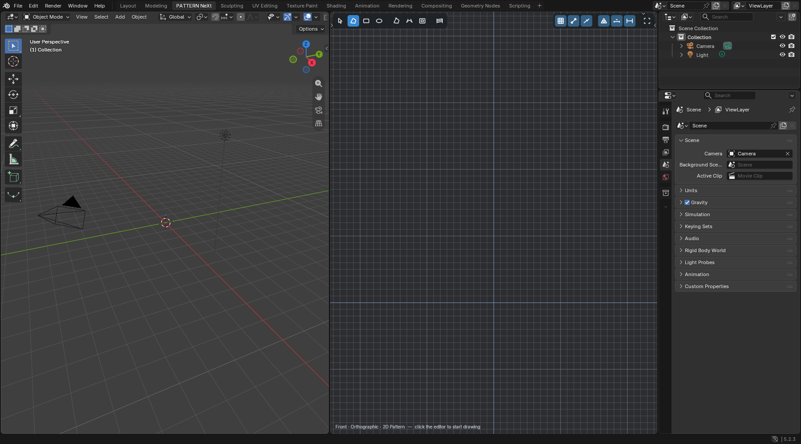 Workspace: 3D left, locked 2D editor right | 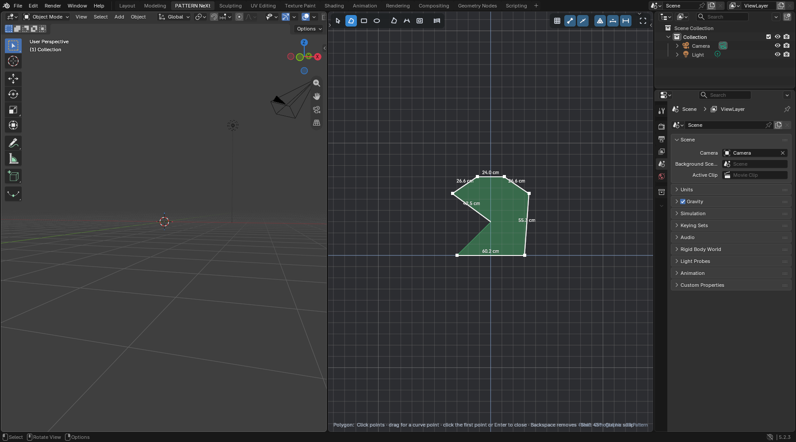 Polygon tool with live lengths and fill preview |
|  Closed: filled, triangulated, panel in 3D | 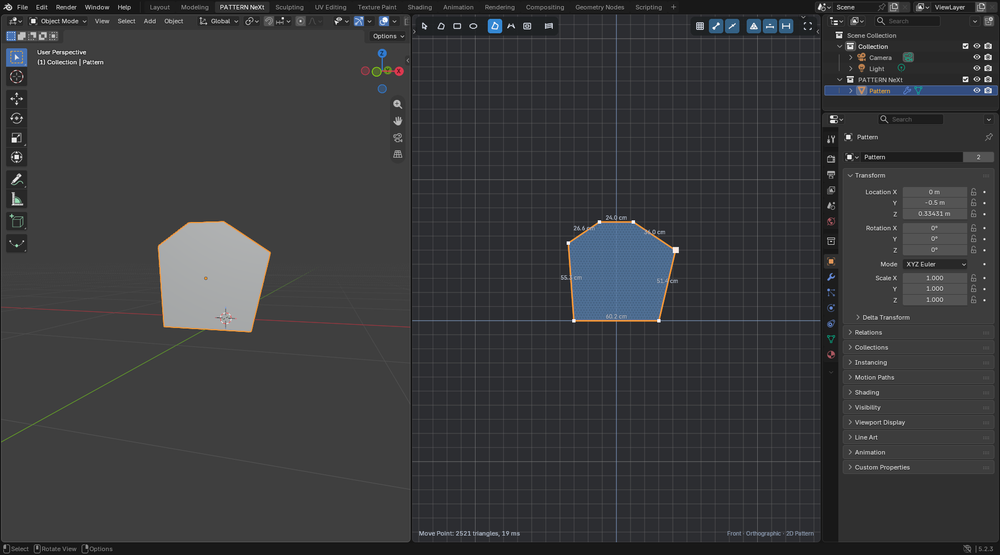 Point moved, mesh regenerated |
| 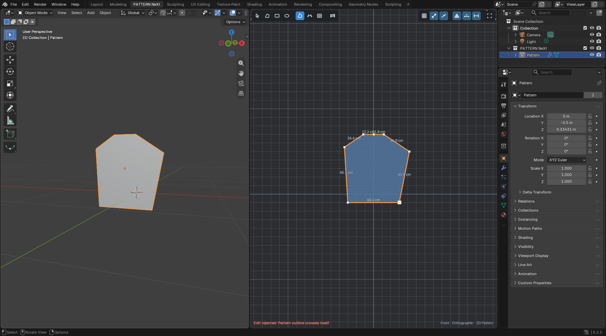 Self-intersecting edit rejected |  Particle Distance 10 mm |
| 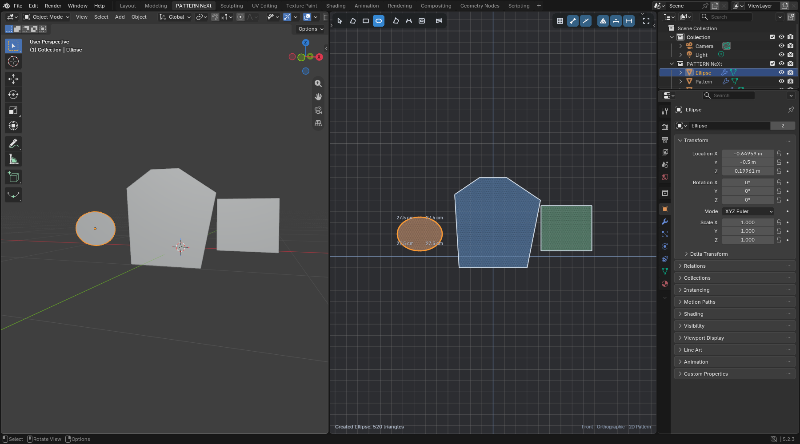 Rectangle and ellipse | 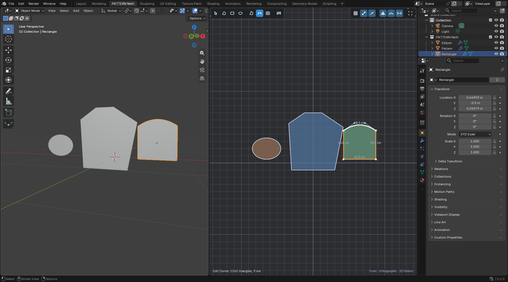 Edit Curve |
| 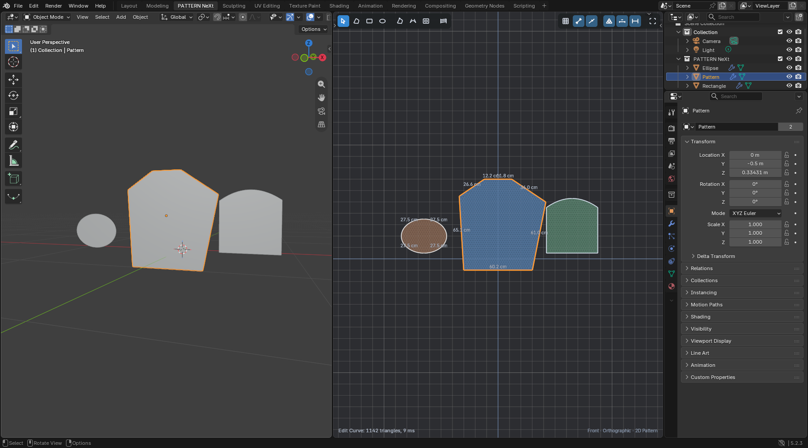 Selection shared by both editors | 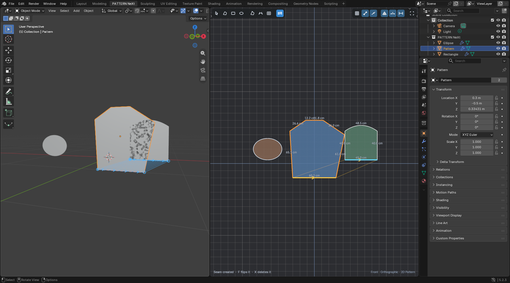 Seam with direction and threads |
| 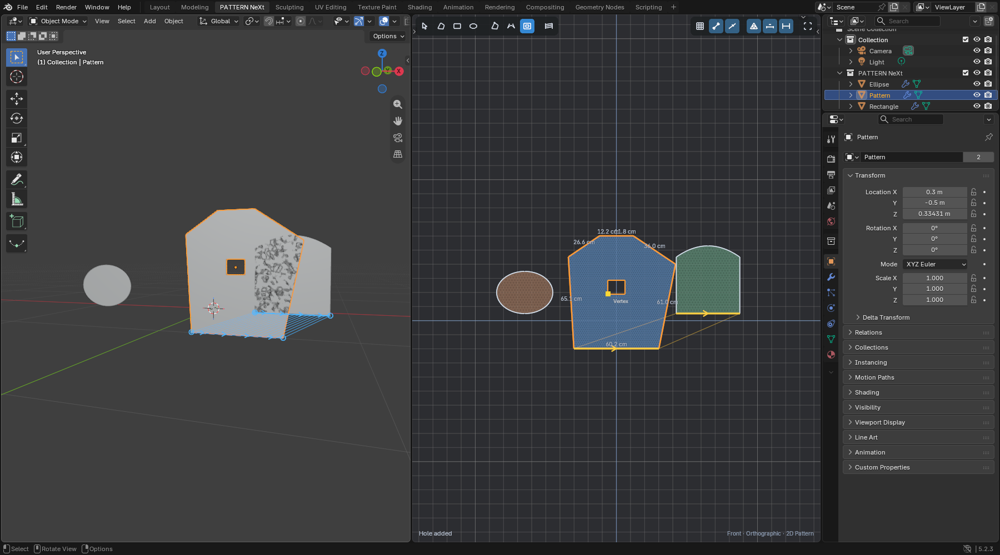 Hole from the Internal tool | 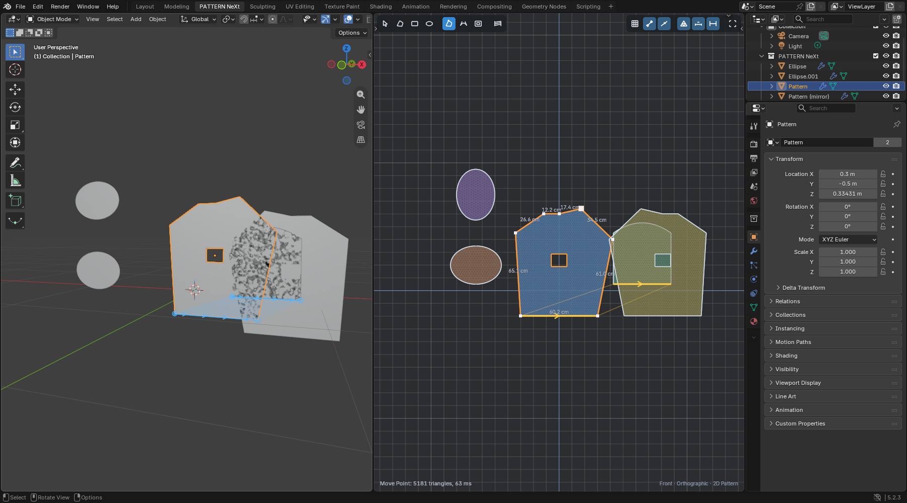 Linked mirror |
|  After 40 × undo and redo | 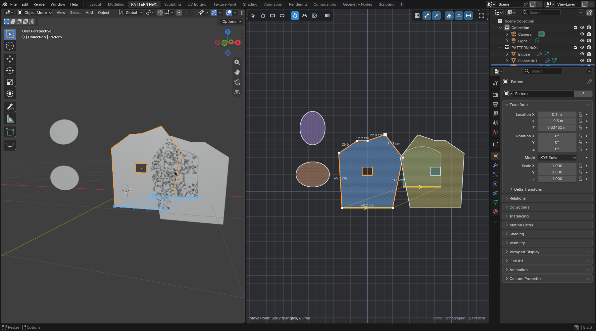 New Blender session, reopened and edited |

## Geometry validation (Blender CDT)

Checks per mesh: area against the analytic outline (holes subtracted),
boundary edges exactly equal to the resampled outline/hole edges,
internal-line edges embedded, all triangles counter-clockwise with positive
area, manifold, no duplicate triangles, interior vertices and triangle
centroids inside, and the one-sided Hausdorff distance from the analytic
Bezier outline to the mesh boundary within the 1 mm tolerance.

| Shape | Verts | Tris | Interior verts | Rel. area error | Boundary dev. (mm) | Min angle | Mean min angle | Mesh ms |
| --- | --- | --- | --- | --- | --- | --- | --- | --- |
| 1 triangle | 318 | 561 | 245 | 1e-16 | 0.00 | 26.2° | 57.6° | 11.8 |
| 2 rectangle | 699 | 1296 | 599 | 0 | 0.00 | 36.9° | 56.5° | 11.7 |
| 3 concave L | 372 | 632 | 262 | 2e-16 | 0.00 | 36.0° | 54.0° | 5.9 |
| 4a complex concave star | 454 | 738 | 286 | 2e-16 | 0.00 | 22.4° | 52.6° | 7.0 |
| 4b complex concave comb (5 slots) | 541 | 880 | 341 | 2e-15 | 0.00 | 36.0° | 53.1° | 8.7 |
| 5 ellipse | 521 | 960 | 441 | 1.5e-3 | 0.43 | 31.2° | 57.0° | 6.5 |
| 6 Bezier sleeve cap (mixed straight/curved) | 683 | 1271 | 590 | 5.6e-4 | 0.37 | 31.6° | 57.2° | 8.3 |
| 6b curved bodice | 917 | 1727 | 812 | 5.5e-4 | 0.42 | 30.2° | 57.4° | 11.8 |
| 7 narrow neck 15 mm at 20 mm spacing | 374 | 644 | 272 | 2e-16 | 0.00 | 36.0° | 54.9° | 5.1 |
| 7b sliver triangle 600 × 12 mm | 62 | 60 | 0 | 0 | 0.00 | 1.1° | 22.6° | 0.8 |
| 8 near-collinear points (±0.01 mm) | 551 | 1005 | 456 | 0 | 0.00 | 35.8° | 57.0° | 6.6 |
| 9 after 60 random point moves | 679 | 1256 | 579 | 2e-16 | 0.00 | 28.3° | 57.2° | 8.3 |
| 10 bodice at 5 mm | 14218 | 28020 | 13804 | 3.1e-4 | 0.18 | 26.7° | 59.5° | 371 |
| 10 bodice at 10 mm | 3598 | 6986 | 3390 | 3.6e-4 | 0.23 | 27.2° | 59.1° | 66 |
| 10 bodice at 20 mm | 917 | 1727 | 812 | 5.5e-4 | 0.42 | 30.2° | 57.4° | 12 |
| 10 bodice at 40 mm | 248 | 434 | 188 | 9.0e-4 | 0.59 | 28.6° | 55.4° | 3.4 |
| 11 hole | 869 | 1607 | 738 | 5.8e-4 | 0.42 | 30.2° | 56.3° | 16.6 |
| 12 internal line | 909 | 1711 | 804 | 5.5e-4 | 0.42 | 28.3° | 56.2° | 14.0 |

Straight outlines are reproduced exactly (area error at floating-point
level). For curves the area error is the chord approximation, bounded by the
documented 1 mm tolerance (measured ≤ 0.59 mm). Case 9 meshed and passed all
checks after every one of the 60 accepted moves, not only at the end. The
sliver triangle (7b) is thinner than one Particle Distance, so its triangles
inherit its 1.1° angle; every other shape stays above 22°.

Adapter boundary (`cloth_next/blender/pattern_next/adapter.py`): the
geometry run also takes a `GarmentSnapshot` of 27 panels and one seam; every
panel's rest vertices match its Blender mesh, and the seam's vertex paths are
identical to the sides of the Cloth NeXt sewing definition it produced.

Invalid shapes, all rejected with a clear message and no mesh written:
open contour (`OPEN_CONTOUR`), self-intersection (`SELF_INTERSECTION`),
duplicate points (`DUPLICATE_POINT`), zero area (`ZERO_AREA`), hole outside
the pattern (`HOLE_OUTSIDE`). Further codes covered by unit tests:
`TOO_FEW_POINTS`, `ZERO_LENGTH_EDGE`, `HOLE_INTERSECTS`, `HOLE_NESTED`,
`LINE_OUTSIDE`, `LINE_INTERSECTS`, `TOO_DENSE`, `TRIANGULATION_FAILED`.

### Built-in constrained Delaunay: what it does and does not solve

`mathutils.geometry.delaunay_2d_cdt` is exact and fast and is used for every
triangulation. On its own it only connects the given points (a rectangle
becomes two triangles), it has no density control, and with output type 0
(convex hull) it produced zero-area sliver triangles along slanted straight
edges whose resampled points are not exactly collinear in floating point.
PATTERN NeXt therefore resamples the boundary, seeds interior particles,
triangulates with output type 1 (only inside the outline face; holes removed
afterwards) and keeps a sliver-flip safety pass.

## Performance

Measured in Blender 5.2.3 (`geometry.json`, `acceptance-create.json`):

| Case | Total | Meshing | Mesh write | Triangles |
| --- | --- | --- | --- | --- |
| Small panel 30 × 20 cm at 20 mm | 3.7 ms | — | 0.8 ms | 350 |
| Curved bodice ~1 m² at 40 mm | 18 ms | 16 ms | 1.7 ms | 2 100 |
| Curved bodice ~1 m² at 20 mm | 81 ms | 75 ms | 6.2 ms | 8 467 |
| Curved bodice ~1 m² at 10 mm | 466 ms | 448 ms | 17 ms | 33 932 |
| Curved bodice ~1 m² at 5 mm | 2.9 s | 2.87 s | 74 ms | 135 906 |
| 400 outline points at 10 mm | 158 ms | 151 ms | 6.7 ms | 11 656 |
| 20 patterns in one scene, edit one | 16.7 ms | | | only the edited pattern rebuilt (revision check) |
| Interactive point drag on the acceptance panel | 59–63 ms per remesh (5 181 triangles) | | | |
| 2D editor redraw (6 patterns, mesh display on) | 13.0 ms | | | |
| 3D view redraw | 3.0 ms | | | |

Editing remeshes only the edited pattern (and a linked mirror partner).
While dragging, a pattern whose last remesh took under 35 ms is remeshed
live (throttled to ~30 Hz); larger ones show a live validated outline and
remesh on release. All Blender data is written on the main thread.

## Regression

* Full pytest suite: 2765 passed, 40 skipped (platform/engine-dependent), 0
  failed after adapting `tests/fake_bpy.py` (added `UIList`, `WindowManager`,
  `Material`, `TOPBAR_MT_window`) and `tests/test_validation_state.py`
  (expects one more load/undo/redo handler, the single PATTERN NeXt handler,
  checked by marker). *(Final number: see the commit message of this report;
  re-run with `python -m pytest -q`.)*
* AETHER and GAIA code is untouched. Existing 3D overlays (Sewing, Object
  Attachments, Linked Colliders, Wind, Water Flow, TETHYS, the floating
  simulation toolbar) received a three-line guard so they do not draw inside
  the 2D Pattern editor; they are unchanged everywhere else.
* The existing sewing data model is unchanged; PATTERN NeXt writes regular
  sewing definitions through `sewing._commit`.

## Feature parity with Marvelous Designer (2D pattern authoring)

Based on the public Marvelous Designer manual (workflow concepts only; no
code, icons or branding used).

### Implemented

| Marvelous Designer | PATTERN NeXt |
| --- | --- |
| 2D Pattern window next to the 3D window | Native workspace tab, locked front-orthographic 2D editor + free 3D view |
| Polygon (click points, drag for curve points, click start to close) | Polygon tool (H), same interaction, live lengths, fill preview, snapping |
| Rectangle / Circle, numeric size | Rectangle (S), Ellipse (E), click for exact size, parametric size kept |
| Automatic pattern mesh, Particle Distance | Automatic constrained interior mesh, Particle Distance per pattern, 1 mm curve tolerance |
| Edit Pattern: move points/segments, add point, delete point | Edit Pattern (Z): points, edges, double-click add, X delete, right-click edge menu |
| Edit Curvature / curve points with handles | Edit Curve (V): bend edges, tangent handles, smooth/corner toggle, straight ↔ curve |
| Segment length | Set Edge Length (right-click) and length labels in cm |
| Internal polygon converted to hole, internal lines | Internal tool (G): holes and internal lines embedded in the mesh |
| Segment sewing, seam direction | Sewing (M): two edges, direction from click positions, F flip, colours/arrows/threads |
| Select/move/rotate pattern, copy/paste, duplicate, delete | Select (Q): move, R rotate, Ctrl+C/V, Shift+D, X |
| Symmetric pattern (linked) | Mirror with Linked Symmetry |
| Snap to grid / points / segments | Grid, point and edge snapping, Shift angle steps |
| Arrangement | 3D panels in the 3D view (Blender transforms), Front/Back placement, Reset Arrangement |

### Partial

| Feature | Status |
| --- | --- |
| Free sewing / M:N sewing | One edge (between two outline points) per side; multi-segment sides are supported in the data model but the tool picks single segments. The Cloth NeXt Sewing editor still offers free/multi sewing on the meshes. |
| Editing holes and internal lines | Created with the Internal tool and removable in the sidebar; their points cannot yet be dragged with Edit Pattern. |
| Arrangement points / bounding volumes around the avatar | Not yet; panels are placed with Blender's transform tools and Front/Back. |
| Pattern display controls | Mesh, lengths, seams toggles, fabric colours; no texture display in 2D yet. |
| Numeric transform | 2D position/rotation fields and primitive width/height in the sidebar; no numeric point editing. |
| Undo granularity | One undo step per completed edit; live drag states are not separate steps (by design). |

### Future milestones

* Simulation with AETHER (fitting the sewn panels on the avatar, Live
  Simulation from the workspace). The Simulation button is deliberately not
  shown until this works.
* Fold lines / fold angles on internal lines, darts and pleats tools, notches.
* Trace / unfold from 3D, grading, pattern layers, UV editor tools.
* Avatar arrangement points.

## Known limitations

* Panels are staged in one plane (Y = −0.5 m) laid out like the canvas;
  patterns that overlap on the canvas overlap in 3D until arranged.
* Very fine Particle Distance on large panels is slow to mesh (1 m² at
  5 mm ≈ 2.9 s); dragging such a pattern shows the outline live and remeshes
  on release.
* The 2D editor's own input runs as a modal session per window while the
  workspace is shown (the Cloth NeXt modal-editor convention). Blender
  postpones auto-save while any modal operator runs, so auto-save does not
  happen while the PATTERN NeXt workspace is open; manual saving works.
* Editing a panel mesh in Edit Mode is overwritten by the next pattern edit
  (the pattern is the source of truth).
* The Blender header of the 2D editor is hidden for a clean drafting view
  (View menu not available there; N still opens the sidebar).
* Pre-existing, unrelated: the Sewing GUI acceptance check "Ctrl+Z undoes
  the last seam and exits cleanly" fails on `main` as well.

## Next development steps

1. AETHER fitting milestone: simulate PATTERN NeXt panels with their seams
   from the workspace (adapter data: panels are Cloth NeXt Cloth objects with
   flat rest meshes, UVs, arrangement transforms and sewing definitions).
2. Drag editing of hole and internal-line points; fold angles on internal
   lines.
3. Multi-segment and free seam picking in the Sewing tool; seam length
   mismatch warnings.
4. Arrangement points around the avatar.
5. Faster meshing for very dense panels (move the lattice clearance test
   into a spatial grid).
